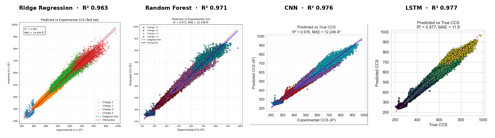
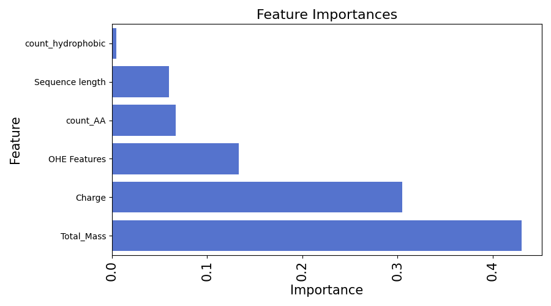
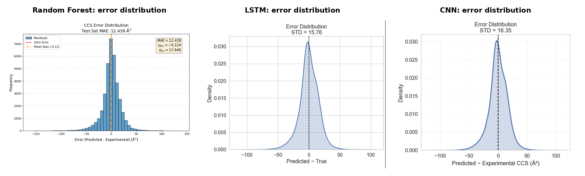
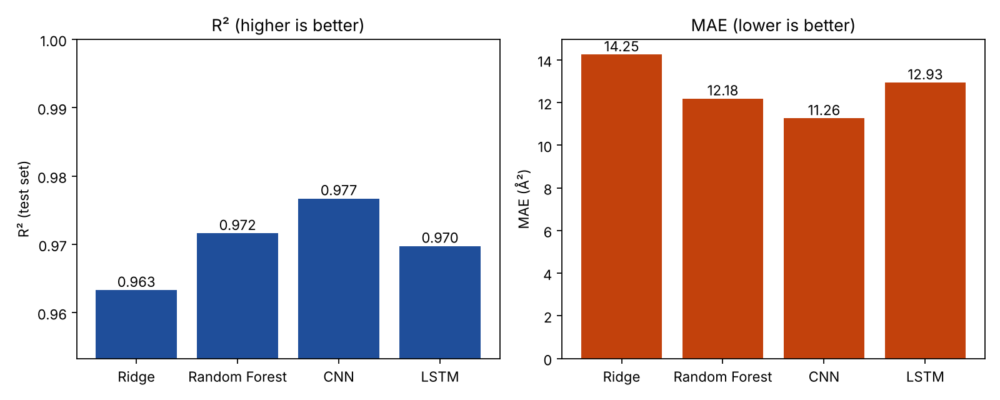

# Machine Learning vs. Deep Learning for Peptide CCS Prediction

**A research project in the Computational Mass Spectrometry group of Prof. Mathias Wilhelm at the Technical University of Munich (February 2025 – January 2026).**

Can classical machine learning keep up with deep learning when predicting the **collision cross section (CCS)** of peptides from their sequence? We compared four models, **Ridge Regression, Random Forest, a 1D-CNN and an LSTM**, on an ion mobility dataset from the Wilhelm lab with **844,122 peptide measurements** (240,000+ unique peptides after cleaning).


<sub>Predicted vs. experimental CCS on the held-out test set, coloured by charge state (figures from our project report).</sub>

**Team:** Lara Groß, Anna Niederlechner, Silja Ohlsen · **Supervision:** Computational Mass Spectrometry, Prof. Dr. Mathias Wilhelm, TUM

## Why CCS?

Ion mobility spectrometry separates ions by their size and shape in a drift gas. The resulting CCS value is a fourth identifier for a peptide, in addition to retention time, m/z and fragment spectrum. It helps to tell apart isobaric and isomeric peptides that mass spectrometry alone cannot separate. Measuring CCS requires special instruments, so accurate predictions from sequence can add this dimension to any proteomics dataset.

## Results (test set, from our report)

| Model | R² | MAE (Ų) | Pearson r |
|---|---|---|---|
| Ridge Regression | 0.963 | 14.41 | |
| Random Forest | 0.971 | 12.44 | |
| CNN | 0.976 | 12.25 | 0.988 |
| **LSTM** | **0.977** | **11.80** | **0.988** |

- **Both deep learning models are best**, and they are practically tied. This suggests that CCS is driven mostly by local sequence motifs and charge rather than long-range dependencies, so the cheaper CNN is a good choice at proteome scale.
- **The Random Forest comes close** (R² 0.971) at a fraction of the cost. Total mass (≈ 43 %) and charge (≈ 30 %) dominate its feature importances.

  
- **Even the linear Ridge baseline reaches R² 0.963**, which shows how strongly CCS scales with mass and charge. The errors that remain are mostly in charge states +3 and +4, where peptides are more flexible.


- **Modifications** (methionine oxidation, N-terminal acetylation) added almost nothing once the sequence and charge were known.

## About this code

The code in `src/` and `scripts/` is a clean re-implementation of the methods from our report, written in October 2026 so that the full pipeline is in one place and reproducible. My original experiments from the project are in [`exploration/`](exploration/).

### Re-run of the pipeline (October 2026)

All four models were re-trained with this code on the cleaned dataset (243,088 peptides, same 75/10/15 split). Because this ran on a 2-core CPU, the deep models were trained for only **10 epochs** (report: 45–50) and the Random Forest used **100 trees of depth 30** (report: 1000 trees, depth 55):

| Model | R² | MAE (Ų) | Pearson r | report R² |
|---|---|---|---|---|
| Ridge Regression | 0.963 | 14.25 | 0.981 | 0.963 |
| Random Forest (reduced) | 0.972 | 12.18 | 0.986 | 0.971 |
| CNN (10 epochs) | **0.977** | **11.26** | **0.989** | 0.976 |
| LSTM (10 epochs) | 0.970 | 12.93 | 0.985 | 0.977 |



Ridge, Random Forest and CNN reproduce the report closely. The LSTM falls behind after only 10 epochs; its validation loss was still fluctuating, so it needs the full training schedule. Metrics are in `results/*.json` and all plots in [`results/figures/`](results/figures/).

## Method

```
peptide sequence ─┬─► one-hot (32 × 20) ──────────────────────────┬─► Ridge / Random Forest
modifications  ───┤   + amino acid counts, hydrophobic count,      │
charge, m/z    ───┘     length, total mass, m/z, charge  (≤ 690)   │
                                                                   │
one-hot sequence (32 × 20) ─► LSTM (64)  or  Conv(64,k5) + 2 residual blocks + avg-pool ─┐
charge (one-hot) ─► dense ────────────────────────────────────────────────────────────────┼─► dense ─► CCS
modification flags ─► dense ──────────────────────────────────────────────────────────────┘
```

**Data cleaning** (`src/ccs/data.py`): exact duplicates are removed. Near duplicates (same peptide, modification and charge, but different CCS) are collapsed to the entry with the best Andromeda score. Peptides longer than 32 residues are dropped; 32 is the IQR upper limit of the length distribution and removes 1.7 % of the data.

**Split** (`src/ccs/splits.py`): 75 % training, 10 % validation, 15 % test, with 5-fold cross-validation on the training set.

**Models** (`src/ccs/models/`):
- Ridge: standardised features, λ chosen by grid search (best 0.01)
- Random Forest: grid search over 600–1000 trees, depth 30–70, min. samples per leaf 2–10 and `max_features` ∈ {sqrt, 0.5}. Best: 1000 trees, depth 55, 6 samples per leaf, 0.5.
- LSTM: 64 hidden units, dropout 0.2, Adam (lr 1e-3), MSE on min-max scaled CCS, 50 epochs
- CNN: residual 1D-CNN, AdamW (lr 1e-3, weight decay 1e-4), linear warmup, ReduceLROnPlateau, early stopping (max. 45 epochs)

## Usage

```bash
pip install -r requirements.txt

python scripts/explore_data.py data/ccs.csv                     # dataset statistics + plots
python scripts/train_classical.py data/ccs.csv --model ridge --tune --cv
python scripts/train_classical.py data/ccs.csv --model rf       # add --tune for the full grid search
python scripts/train_deep.py data/ccs.csv --model lstm
python scripts/train_deep.py data/ccs.csv --model cnn
python scripts/compare.py                                       # table + comparison figure
pytest -q
```

The dataset is not public; see [`data/README.md`](data/README.md) for the expected format.

## Repository structure

```
src/ccs/           data cleaning, features, splits, metrics, plots, models (Ridge, RF, LSTM, CNN)
scripts/           command-line entry points for each step
tests/             unit tests (features, splits, metrics, model shapes)
exploration/       my original LightGBM experiments from the project
results/           metrics (JSON) and figures produced by the scripts
```

## Team

Lara Groß, Anna Niederlechner and Silja Ohlsen, in the Computational Mass Spectrometry group of Prof. Dr. Mathias Wilhelm, Technical University of Munich. The dataset and the project were provided by the Wilhelm lab.
